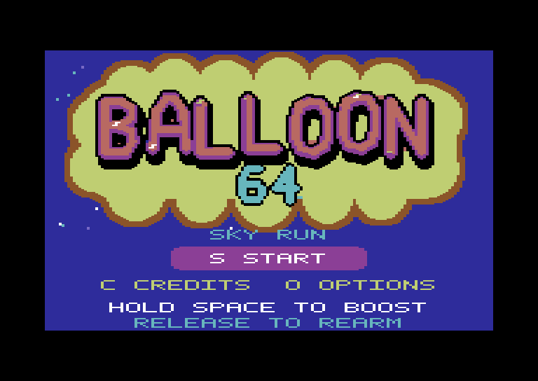
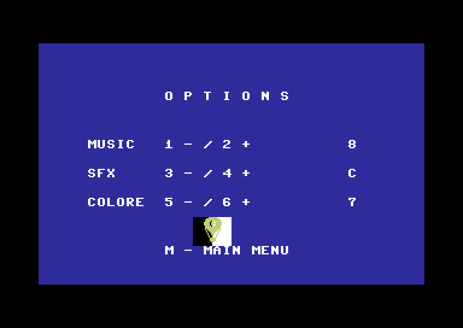
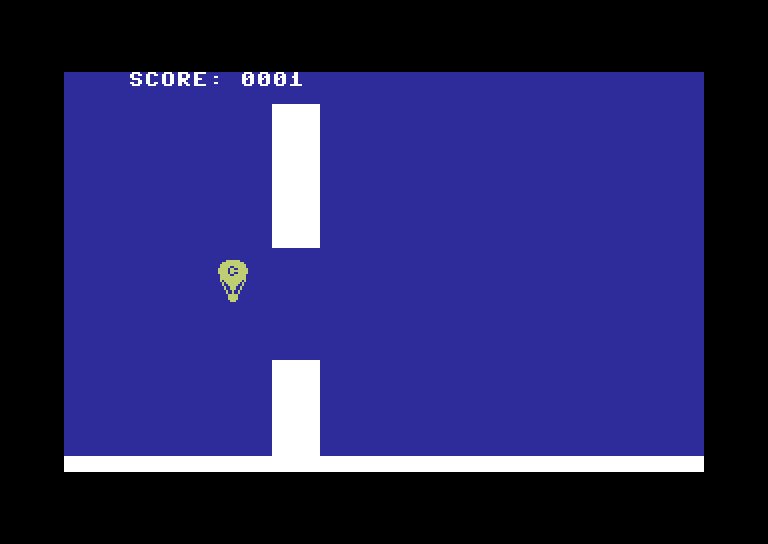

# Balloon 64 — Sky Run

Un piccolo clone di Flappy Bird per **Commodore 64**, scritto in assembly 6502/6510: guida la classica mongolfiera Commodore attraverso gli ostacoli e prova a battere il tuo punteggio. La spinta aumenta mentre tieni premuta la barra spaziatrice; dopo una breve accensione devi rilasciarla per riattivarla.

Il gioco include una schermata iniziale multicolore, una melodia SID ricavata da un MIDI, effetti sonori, Credits e opzioni per regolare i volumi e scegliere il colore della mongolfiera. La partita continua finché non tocchi un ostacolo o i limiti del campo.

## Schermate

Immagini ricavate eseguendo le routine 6502 del PRG e renderizzando la memoria video con palette C64. Il gameplay mostra una partita guidata da input automatici, senza alterare posizione o punteggio. Sono ricostruzioni software, non catture da VICE: l'emulatore si arrestava all'avvio nell'ambiente di preparazione.

### Schermata iniziale


### Opzioni


### Gameplay


## Avvio

Il file **[balloon64.prg](balloon64.prg)** è già compilato. Aprilo con **Autostart** in [VICE](https://vice-emu.sourceforge.io/), preferibilmente con il modello C64 PAL, oppure esegui:

```sh
x64sc -autostart balloon64.prg
```

Se il programma viene caricato senza avviarsi, digita `RUN`.

| Tasto | Azione |
| --- | --- |
| S | Inizia la partita |
| C / O | Credits / Options |
| Spazio | Tieni premuto per aumentare la spinta, rilascia per riarmarla |
| M | Torna al menu |
| 1 / 2 | Abbassa / alza la musica |
| 3 / 4 | Abbassa / alza gli effetti |
| 5 / 6 | Cambia colore della mongolfiera |

Le impostazioni restano valide fino al reset. I livelli e i colori sono indicati in esadecimale, da `0` a `F`. Il punteggio aumenta a ogni ostacolo superato.

## Build

Servono **Java** e **[Kick Assembler](https://theweb.dk/KickAssembler/)**. Il progetto è stato compilato con Kick Assembler **5.25**. Scarica l'assemblatore ed estrai `KickAss.jar` nella cartella `tools/`; non è incluso nel repository. Tutti i dati grafici e musicali necessari alla build sono già presenti.

Da PowerShell, nella cartella del progetto:

```powershell
./build.ps1
```

Oppure indica un JAR conservato altrove:

```powershell
./build.ps1 -KickAssJar 'C:/percorso/KickAss.jar'
```

Su Linux/macOS:

```sh
sh build.sh /percorso/KickAss.jar
```

La build genera `balloon64.prg` nella cartella principale e la mappa dei simboli `src/main.sym`. Non occorrono Python o un emulatore per compilare.

## Contenuto del progetto

```text
src/main.asm          Schermate, input, fisica, collisioni, punteggio e sprite
src/audio.asm         Player SID a tre voci
src/song.asm          Tabelle musicali generate dal MIDI
src/assets/           Bitmap e colori della schermata iniziale
music/source.mid      MIDI sorgente della musica
tools/                Generatori di risorse e test CPU
docs/screenshots/     Immagini ricavate dalla memoria video del PRG
balloon64.prg         Gioco compilato
build.ps1 / build.sh  Script di compilazione
```

## Modifica delle risorse e test

Solo per rigenerare grafica/musica o eseguire i test, installa Python 3 e le dipendenze opzionali:

```sh
python -m pip install -r tools/requirements.txt
python tools/make_title.py
python tools/convert_midi.py
```

Ricompila dopo aver rigenerato le risorse, quindi esegui:

```sh
python tools/test_game.py
```

I test verificano la logica 6502, le transizioni delle schermate, lo sprite, i colori, le collisioni e il confronto delle note con il MIDI. Non sostituiscono una prova interattiva completa con audio nell'emulatore. Il convertitore MIDI è specifico per l'arrangiamento incluso.

Per rigenerare le immagini, dopo la build:

```sh
python tools/capture_screens.py /percorso/VICE/C64/chargen-901225-01.bin
```

Il font ROM viene letto dalla tua installazione di VICE e non è distribuito nel progetto.

Ulteriori dettagli su memoria, fisica e arrangiamento SID sono nelle [note tecniche](docs/technical-notes.md).

## Credits

«Gioco per Commodore 64 creato con l'intelligenza artificiale con l'intento di innervosire il giocatore».

Sprite e MIDI sono stati forniti dall'autore del progetto. Il titolo è ispirato allo stile dei loghi arcade; gli strumenti musicali sono ricreati con le forme d'onda del SID. Il progetto non è affiliato a Commodore o Taito.
